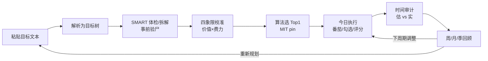
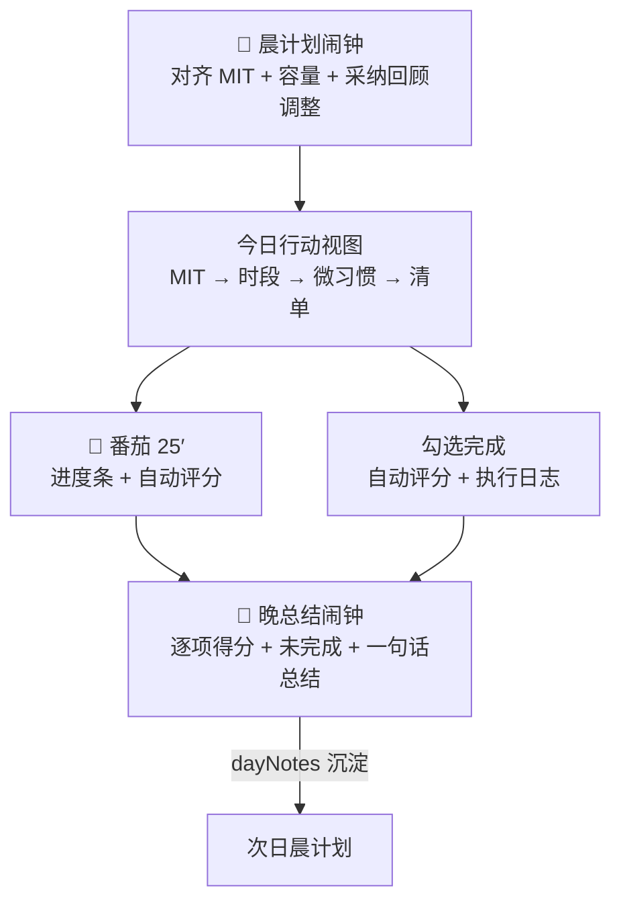

# GoalFlow 产品全景：目的 · 流程 · 功能 · 科学分析

> 本文是 GoalFlow（目标流）的产品级梳理：项目定位、用户流程、功能全景，
> 并从**行为科学**与**可用性**两个角度分析现有设计的依据与可改进点。
> 版本基线：v6.2（2026-11）。

---

## 1. 项目目的

**一句话**：把一整年的目标画成一条「精力河流」，让"当下最重要"自己发光，并用仪式闭环保证执行落地。

**要解决的问题**：待办清单驱动的执行方式，会让人优先做最简单的事，而不是最重要的事。
"重要不紧急"（战略象限）从未被真正安排进时间表。本工具的立场不是教用户"要事第一"，
而是让用户**看见**精力错配——看见，才有选择。

**设计立场**：
- 纯本地、双击即用、无账号无云端（数据主权在用户）；
- 算法替用户做"先做哪个"的决策（减少决策消耗）；
- 不是记录工具，是**行为改变工具**——每个功能背后都应对应一个行为科学机制。

---

## 2. 核心流程

### 2.1 目标生命周期（PDCA 大闭环）

### 2.2 每日流程（小闭环）

### 2.3 每周节奏

- **周一晨**：自动弹周计划——从全部工作流 `im≥4` 的叶子里选 ≤5 块「大石头」（Covey 大石头优先）；
- **每天**：石头条显示在今日面板，可勾选；
- **周日/周末**：周回顾仪式（自动预填：完成叶子、金线动静、核心 vs 救火计数、估 vs 实）→ 填写「下周期调整」→ 进入 `pendingActions` → 次日晨计划一键采纳为今日任务（PDCA 的 Act 落地）。

---

## 3. 功能全景（v6.2）

### 3.1 三视图（v6.0 拆分）

| 视图 | 定位 | 内容 |
|------|------|------|
| ☀ 今日行动 | 每天的主页 | **MIT pin**（Top1+番茄档位+得分折叠）+ 清单内 ② 次重要；头下常驻脉搏条（进度/下一项/连续/容量/表现）；今日面板（闹钟/容量/评分/石头/停滞/精力/审计/习惯/清单）经 zone 折叠；聚焦清单（Top3+Backlog）；英雄卡已于 v8.13 移除 |
| 🎯 目标规划 | 建目标 | 自由文本输入、树形内联维护、SMART 体检+对话拆解、事前验尸、DeepSeek 可选 |
| 📊 归纳洞察 | 分析与校准 | 精力流向图（桑基等视角 × 年/月/周/日）；四象限+完成历史默认折叠；价值×费力、⚡快速赢 |
| 🤖 AI | 枢纽 / 历史 / 配置 | 怎么用 + Key/历史/SMART 条 + 新建项目 CTA；使用历史；Key/Skill；SMART 体检（第四栏，快捷键 `4`） |

### 3.2 仪式层（行为闭环的发动机）

晨计划 / 晚总结 / 周计划 / 周回顾 / 月季回顾——全部由页面弹窗承载，30s 轮询 + 可见性恢复补检查（v6.2 移动端兜底）。「📜 历史」弹窗统一查四类仪式记录（v8.12：晨计划打开快照 / 晚回顾按日聚合 / 周计划履约对照 / 周期回顾留档）。

### 3.3 底层机制

- **选择算法**：`focusScore = 重要度×10 + 期限临近加权`，`pickRanked` 取 Top1/2/3；
- **多工作流**：每个目标流独立树 + 起止日期 + 标签，今日面板跨流汇总；
- **数据**：localStorage 双写备份 + JSON 导出/导入 + ICS 导出；备份格式 v9；
- **度量**：OKR 角色（O/KR/习惯）、`targetNum/targetDone`、pace line、365 热力、习惯 streak；
- **移动端 H5（v6.2）**：底部 tab、查看+勾选、弹窗闹钟补跑、桑基横滑、四象限仅查看。

---

## 4. 科学依据映射（现状）

| 功能 | 行为科学机制 | 理论来源 |
|------|-------------|---------|
| 英雄卡 Top1 | 减少决策消耗；Eat the Frog | Brian Tracy；选择架构 |
| 四象限 | 重要/紧急二维分类 | Eisenhower 矩阵；Covey《高效能人士的七个习惯》 |
| 桑基精力图 | 将抽象优先级转为可感知的视觉错配 | 可视化认知（external cognition） |
| SMART 体检 | 目标具体性提升达成率 | Locke & Latham 目标设定理论 |
| 对话拆解 | 降低畏难（任务粉碎） | 行为激活（behavioral activation） |
| 🛡 if-then 预案 | 执行意图：遇障碍自动触发应对 | Gollwitzer 实施意图（effect size d≈.65） |
| 晨计划/晚总结 | 实施意图 + 反思性实践 | WOOP（Oettingen）；经验学习圈 |
| 周/月/季回顾 → 下周期调整 | PDCA 闭环 | Deming 循环 |
| 周计划大石头 | 先排大事，小事填空 | Covey 大石头隐喻 |
| 🍅 番茄 25′ | 时间盒降低启动阻力；即时反馈 | Cirillo 番茄工作法；心流条件（明确目标+即时反馈） |
| 自动评分 + S/A/B/C | 即时反馈强化；游戏化 | 操作性条件反射；自我效能（Bandura） |
| 习惯 streak 🔥 | 连续性不打断（don't break the chain） | Seinfeld 策略；Atomic Habits |
| 🔍 时间审计 + 偏差缓冲 | 计划谬误的事后校准 | Kahneman & Tversky 规划谬误；参考类预测 |
| ⚠️ 停滞预警 | 重新唤醒被搁置承诺 | Zeigarnik 效应（未完成任务的心理张力） |
| 🪦 事前验尸 | 前瞻性事后分析打破乐观偏差 | Gary Klein premortem |
| 🔥 精力曲线匹配 | 昼夜节律下任务-能量匹配 | Circadian rhythm；Managing Energy（Loehr） |
| 时段钉选（When） | 时间分块 | Time-blocking（Cal Newport） |
| 微动作 | 2 分钟启动规则 | GTD；Fogg 微习惯 |

**结论：现状的理论覆盖已经相当全**——执行意图、PDCA、计划谬误、精力管理这四块（v5.4–v5.6）补齐后，
"规划→执行→反馈→调整"的科学闭环在机制层面已完整。改进空间主要在**闭环的薄弱环节**和**积极心理一侧**（见下）。

---

## 5. 科学角度的改进建议

> 按预期收益 / 实现成本排序。每条：理论 → 现状缺口 → 功能形态。

### P0：低成本 × 高证据强度

**5.1 前一晚预选 MIT（Ivy Lee 法）——当前流程最大的时机缺陷**
- 理论：晨间决策消耗最宝贵的自控资源；睡前写下次日计划可利用潜意识孵化，且显著减少睡前反刍（Scullin 2018，写 todo 缩短入睡时间）；Ivy Lee Method（1918）的核心就是"前一晚定 6 件按序执行"。
- 缺口：晨计划 08:30 当天做——醒来第一件事就是高认知负荷决策。
- 形态：晚总结末尾加「明日 MIT 预选」（1 项主选 + 2 项备选，复用 `pickRanked` 推荐）→ 次日晨计划从"从零计划"降级为"确认/微调"。
- 成本：低（一个 meta 字段 + 两处弹窗串联）。

**5.2 晚总结加「三件好事」（峰终定律 + 积极心理学）**
- 理论：人对一天的记忆由峰值与结尾决定（Kahneman Peak-End Rule）；当前晚总结偏"批判性复盘"（未完成、扣分项），以消极收尾损害长期坚持。Seligman「Three Good Things」实证：连续 7 天记录 3 件好事，幸福感提升、抑郁症状下降，效果持续 6 个月。
- 形态：晚总结在逐项得分之后、一句话总结之前，插入「今天值得记住的 1–3 个时刻」（写入 `dayNotes` 结构化字段，周回顾可引用为"本周高光"）。
- 成本：低。

**5.3 倦怠预警（恢复是表现的一部分）**
- 理论：allostatic load——连续高压低恢复导致表现崩塌；精力管理学派强调"脉动"（应激+恢复交替）。
- 数据已具备：`energyLog` 三级打卡 + 评分日志。
- 形态：连续 3 天「精力低 + 评分 C」→ 今日面板温和提示"建议安排恢复日/降低容量"；周回顾展示 14 天能量趋势线。
- 成本：低（纯读已有数据）。

### P1：补齐流程断点

**5.4 快速捕捉 Inbox（GTD 流程缺口）**
- 理论：GTD 五步 Capture→Clarify→Organize→Reflect→Engage。**本系统从 Clarify 开始，缺 Capture**——念头产生时（手机上！）没有低摩擦入口，等到"规划"时已经忘了。这也是移动端最该补的功能（降级策略恰好允许"只做一件事"）。
- 形态：今日视图一个全局「⚡ 捕捉」按钮（桌面快捷键 `c`），一句话存入 `meta.inbox[]`；规划视图输入面板顶部显示未消化 inbox，一键"转为目标"（追加到 textarea 或插入当前流）。
- 成本：中低。

**5.5 Q2（重要不紧急）投入目标线**
- 理论：Covey 建议高效能者 Q2 时间占比 ≥ 65%；四象限分类的意义最终要落到时间分配上。
- 现状：时间审计已按象限分布展示，但只呈现、无目标值、无趋势。
- 形态：审计块加 Q2 占比目标线（默认 50%，可调），低于阈值标黄；周回顾"核心 vs 救火"已有的数据升级为一行"Q2 投入 xx%（目标 50%）"。
- 成本：中低。

**5.6 习惯叠加 anchor（BJ Fogg / Atomic Habits）**
- 理论：「在[既有行为]之后，我将[新习惯]」——既有行为是最可靠的触发线索，比"每天"这种裸时间承诺有效得多。
- 现状：`ifThen` 是障碍预案（WOOP 的 plan），针对"如果受阻"；微习惯没有附着点。
- 形态：微习惯节点增 `anchor` 文本字段（如"早餐后"/"通勤后"），今日面板微习惯区按 anchor 聚类展示；晨计划提醒补齐空 anchor。
- 成本：低。

### P2：机制强化（值得做，但依赖 P0/P1 稳定）

**5.7 承诺卡（commitment device）**
- 理论：损失厌恶 + 一致性偏见；stickK/Beeminder 证明"明确承诺+对照"显著提升履约率。
- 现状：周计划选了石头就完了，没有"承诺"仪式感；周回顾虽有对照但缺少"你当时承诺了"的呈现。
- 形态：周计划确认时生成承诺卡（本周 N 块石头 + 一句话意图，签名式按钮"我承诺"）；周回顾开篇先展示承诺卡再进入统计。
- 成本：中。

**5.8 目标梯度效应可视化**
- 理论：越接近完成动力越强（Kivetz 咖啡卡实验）；"已完成 8/10"比"还剩 2 个"更能驱动最后冲刺。
- 现状：进度数据全有，但呈现偏"仪表盘式"中性。
- 形态：KR 接近完成（≥80%）时英雄卡/侧栏加冲刺提示；子树进度在 90%+ 时显示"还剩 N 个叶子"。
- 成本：低。

**5.9 90′ 深潜块（ultradian rhythm）**
- 理论：BRAC 基本休息-活动周期 90–120 分钟；周回顾模板里"深潜块"概念已存在但没有工具支持。
- 形态：番茄钟除 25′ 外支持 50/90′ 长模式（长模式评分加权）；日视图时段支持整块占用。
- 成本：中。

**5.10 目标归档与庆祝**
- 理论：完成仪式的闭环（termination ritual）强化自我效能；保留已完成目标流在列表里造成视觉噪音与"永远做不完"的错觉。
- 形态：工作流 100% 叶子完成 → 庆祝卡 + 归档区（只读可查，不进今日汇总）。
- 成本：中。

### 不建议做（科学上站不住或与定位冲突）

- ~~惩罚机制（扣分/罚款）~~：外在惩罚侵蚀内在动机（自我决定论）；评分系统保持"只奖励"。
- ~~社交排行榜~~：与"纯本地单机"定位冲突，且社会比较对内在目标有害无益。
- ~~连续打卡断签惩罚~~：现有 streak 只做正向展示是对的，不要加断签负反馈。

---

## 6. 可用性角度的改进建议

| # | 问题 | 状态 | 说明 |
|---|------|------|------|
| U1 | 今日面板信息过载 | ✅ 折叠已做 · 简洁模式 backlog | zone/fold 渐进披露；「简洁模式」开关见下一阶段 |
| U2 | 新手空状态无引导 | ✅ | onboard 三步卡 + 首次 loadDemo |
| U3 | 备份意识 | ✅ | >7 天 `#todayBackupBar`；设置内导出 |
| U4 | 删除无撤销 | ✅ | `showUndoToast` 10s 快照 |
| U5 | 无键盘效率 | ✅ | `1/2/3/4` · `t` · `c` · `/`/`⌘K` · 空格番茄 · Esc；见 DESIGN 快捷键表 |
| U6 | a11y 薄弱 | ⬜ 下一阶段 | 焦点环、aria-expanded、light 对比度 |
| U7 | 多设备不同步 | 不做/远期 | 本地定位；ICS/JSON 桥接 |
| U8 | 移动端只有查看 | ✅ | mtab 中央 ⚡ 捕捉 + 行内编辑 |

### 下一阶段 backlog（规范性 / 视觉）

- 简洁模式默认只留问候·MIT·清单
- a11y（U6）+ light 硬编码清理
- rowChrome 统一行结构 · Things 视觉回灌 · 洞察空态/动效
- app.js 按域拆分 · 时间窗口文案「人空闲 / 项目收窄」

---

## 7. 建议路线图

| 阶段 | 内容 | 状态 |
|------|------|------|
| v6.3 | 5.1 前一晚预选 MIT · 5.2 三件好事 · 5.3 倦怠预警 · U1 折叠次级块 · U3 备份提醒 · U2 onboarding · U4 撤销 | ✅ 已完成（2026-11-23，含 U2/U4 提前并入） |
| v6.4 | 5.4 捕捉 Inbox（移动端 mtab 中央 ⚡FAB 入口 ✅）· 5.5 Q2 目标线（时间审计块+周回顾 Q2 行，可调 10-90%）· 5.6 习惯 anchor（⚓ 习惯叠加聚类）· U5 快捷键（1/2/3 切视图 · t 今日 · c 捕捉 · 空格番茄暂停）· 番茄暂停/继续 | ✅ 已完成（2026-11-25，随 v7.x 重构并入，CSS 补录） |
| v6.5 | 5.7 承诺卡（周计划保存→承诺卡「我承诺」落库 · 周回顾开篇对照履约）· 5.8 梯度冲刺（子树 ≥80% 英雄卡 🔥 冲刺提示）· 5.9 深潜块（番茄 25/50/90′ 三档 · 90′ 评分加权 · 条显 🌊）· 5.10 归档（叶子 100% 完成 → 🏆 归档+庆祝卡 · 侧栏归档区可恢复 · 归档项退出今日汇总/本周承诺/停滞预警/大石头候选） | ✅ 已完成（2026-11-25，22 项全量核查通过） |
| v7.9 | 项目每日可安排时段（winStart/winEnd 注入 AI 排期）· AI 分解失败明示原因+回滚空项目 · 未开始项目不进今日（planDate 到期自动转入）· 全局唯一 MIT（跨项目英雄卡，番茄跨项目归账）· 今日清单时间排序（slot 粗排）+ ⏰提醒/🕐计划时间分工注明 | ✅ 已完成（2026-11-25，22 项全量核查通过） |
| v8.0 | **今日页 UX 精简**（U1 深化）：默认极简 = MIT+清单+习惯，次级全部可点开默认收折——英雄卡 7pill→3pill（得分/进度/节奏收进 details）· 番茄三档改主按钮+档位下拉 · 闹钟条 8 控件→🌅🌙时间+开关+「⏰仪式」菜单 · 度量条 KR 收「指标▾」· 习惯 meta 4 段→1 条 · 容量 3 条→1 条+周预算折叠 · planShare 迁入状态区 · 移动端触控 ≥36px、仪式菜单底部弹出 | ✅ 已完成（2026-11-25，20 项全量核查通过） |
| v8.1 | **移动端 app 化深化**：①布局去「panel 套 panel」→ 今日块/折叠区/英雄卡统一 16px 分组卡（iOS inset-grouped 感）②大石头/情境 chips 折行→单行横滑 ③hero-main 17→21px、大标题 30→32px ④行内 meta 减载：默认只留 项目/🕐/📈/等待阻塞，循环/anchor/标签/剩n天 收进 ⋯ 展开 ⑤底部 tab 玻璃质感与顶栏一致 | ✅ 已完成（2026-11-25，22 项全量核查通过） |
| v8.2 | **AI 排期五修复**：①AI 产出兜底排期——LLM 漏给 start/date 的叶子本地顺排补齐（窗口内顺接 10min 间隔，每个叶子必有具体时间；start 解析兼容「19点/7:30pm」）②有计划时间的今日任务自动带提醒 = 开始前 5 分钟（可改可清，手动清空当天不回填）③MIT 漏项修复——英雄卡候选池与今日清单同源 ④每日可安排时段支持多段（开始+时长，动态行编辑，AI 排期逐段注入）⑤AI 分解加载统一为居中全屏遮罩（创建项目流程原用底部 toast） | ✅ 已完成（2026-11-25，29 项核查 + 20 项排期冒烟通过） |
| v8.3 | **四问题修复**：①精力超标弹窗点多次才退出——AI 递归插入时尾部副作用每层都跑，现只跑最外层 ②桌面字号整体 +1 档（body 14→15px，桌面规则 ≤13px 全抬一档共 332 处，移动端 media 块不动）③核查/冒烟脚本常驻 `scripts/checks/`（`node scripts/checks/run.cjs` 一键全跑，不再用完即删）④Chrome 提醒无兜底——到点走 `showTodayAlarm` 三通道（未授权也有 toast+页头横幅），行内 ⏰ 填时间自动引导授权；附带修：AI 排期「有 start 无 date」任务按今天计入占用避免时间重叠 | ✅ 已完成（2026-11-25，run.cjs 5 环节 45 项全绿） |
| v8.4 | **五项修复**：①AI 报错可见——新建项目分解流程也写 AI 使用历史（via:'create'），失败记具体原因（401/402/429/网络）+原始返回片段，历史失败行内联错误摘要，空 tasks 不再无声「成功」②AI 分解假流程展示——全屏遮罩分步演出（理解→拆解→估时→落窗口→校验，1.1s/步）③最后一个项目可删（删空回空白初始态）；当前项目框与其他统一（灰框+左竖条，不再整圈高亮）④项目设置删除按钮被遮挡——wfm-body 内容区可滚动，底部按钮不再被裁 ⑤创建项目一键模板——📚学习/💪健身/💼副业/📖读写 4 套，预填表单+直接生成任务树（走兜底排期，不耗 API 额度） | ✅ 已完成（2026-11-25，run.cjs 6 环节 75 项全绿） |
| v8.5 | **回归修复+结果弹窗**：①修 v8.4 回归「保存项目后无法 AI 分解」——模板选择残留在复用弹窗的 dataset 上劫持后续创建，打开弹窗即重置 + chip 可再点取消 ②分解/模板完成弹窗展示真实排期结果（兜底排期后的时间块预览）+ 今日安排列表，按钮直达任务树/今日行动 | ✅ 已完成（2026-11-25，run.cjs 7 环节 88 项全绿） |
| v8.6 | **模板×AI 共存+错误弹窗**：①选了模板且填了描述 → 走 AI 分解（模板作为失败兜底自动回落，不删项目、不双弹窗）；只选模板无描述 → 纯模板创建 ②修 `anchorD.getTime is not a function`——insertAITasks 的日期锚点三调用方传字符串，v8.4 模板自动填开始日期后必炸，现调用方与被调方双层归一化 ③分解失败弹窗 `showAIErrorModal`（原因+原始片段+回滚说明+一键跳 AI 历史），替代一闪而过的 toast ④AI 视图移除「AI 分解目标」模块（入口统一在新建项目流程），保留使用历史/配置详情/SMART 体检，历史「复用」降级为复制到剪贴板 | ✅ 已完成（2026-11-25，run.cjs 8 环节 111 项全绿） |
| v8.7 | **模板必过AI+排期泄漏+工作流过滤**：①选模板也进 AI 分析——仅当模板自带已排好具体时间的任务（date/start）才直接套用；无描述时用模板名+方向+骨架合成目标文本，AI 失败仍自动回落模板骨架 ②修「今日执行混进明天任务且无时间」根因——兜底排期把任务排到次日会带 deadline=排期日，被「明天到期/日尺度/快赢」条款拉回今天；现今日池最前排除 planDate>今天，到当天自动转 time 再进 ③今日视图「🌐全部项目/🎯当前项目」过滤开关（持久化）——默认跨项目全局一致，打开后 MIT/今日执行/顶栏计数只看当前项目；容量条保持全局口径 ④审计修顶栏「今日 X/Y 完成」——原只算当前项目且完成数恒 0，现与清单同源+完成数取执行日志 | ✅ 已完成（2026-11-25，run.cjs 10 环节 141 项全绿） |
| v8.8 | **提到今天+删除链路+系统通知**：①备选（收件箱☁以后）与 Backlog 条目「→今天」自动分配今日空闲时间——跨项目收集已排块、在项目窗口内找空隙（10 分钟缓冲、不排过去），窗口满明示未排；支持一键撤回（字段快照/收件箱条目回待澄清）②删除项目级联清理——本周大石头 rocks、待办行动、明晚预选、带宽、时间预算、习惯打卡记录同步删除，不再留孤儿引用 ③修「最后一个项目删除没反应」——原生 confirm 在部分 WebView 被静默吞，改页内确认弹窗（红色删除按钮）④重要弹窗支持系统通知——AI 结果/失败/删除项目同步发 OS 通知（未授权时弹窗内给「🔔 开启系统通知」按钮）⑤渲染管线容错——单面板抛错不再拖垮整组渲染（四象限等「没同步更新」的系统性根治） | ✅ 已完成（2026-11-25，run.cjs 12 环节 194 项全绿） |
| v8.9 | **模块间增删同步审计（8 处修复）**：穷举全部 16 处 `state.nodes =` 赋值点 + 删除/采纳链路，建立三级引用清理体系——①节点级 `purgeNodeRefs`（大石头/明晚预选/习惯打卡，带备份供撤销还原）：修「删除任务后大石头还在、点了没反应」「习惯打卡记录成孤儿」②整树替换级 `purgeCurrentTreeRefs`（重新解析/AI 分解/模板应用三处共用）：修「重新解析后旧任务的大石头、置顶、番茄钟全失效但残留」③项目级 `purgeWorkflowRefs`（删除项目/清空全部共用，补番茄钟解绑）④向导重新规划删子树补级联（此前绕过删除函数）⑤「清空全部」改页内确认弹窗 + 快照含全部配置（撤销清空现在能完整还原）+ 清掉全部孤儿引用 ⑥修「晨计划采纳行动后今日面板不刷新」（同项目采纳漏了界面刷新）⑦番茄钟绑定被删任务/项目时自动解绑 ⑧审计确认安全的既有容错：番茄钟死引用双层兜底、明晚预选死引用静默跳过、收件箱目标项目失效自动回落当前项目 | ✅ 已完成（2026-11-25，run.cjs 14 环节 229 项全绿，dist 723.2KB） |
| v8.10 | **增改之后同步审计（9 处修复）**：审计「添加/修改」链路的跨模块一致性——①修「习惯打卡连续天数刷新即回滚」：打卡/强度日志写在评分落盘之后，调用方只存了目标树没存配置，现勾选出口统一落盘 ②修「取消勾选后统计虚报」：执行日志只增不减，「✅今日已完成」/顶栏 X/Y/时间审计/计划对比全部多算，现取消对称回滚（只删最新一条，计数同步回退） ③修「页面挂着过夜今日停在昨天」：跨午夜自愈——30 秒轮询+唤醒补跑检查换天，自动刷新「今天」并把到期的未来排期任务转入今日 ④修「恢复备份后配置刷新即丢」：恢复的配置此前不落盘 ⑤修「精力打卡后 MIT 顺序不更新」：精力高峰变化现在当场重排 ⑥修「今日面板删任务留孤儿引用」：统一走删除级联（此前是独立实现绕过清理） ⑦快照/备份恢复改页内确认弹窗（部分 WebView 吞原生确认框） ⑧快照/备份恢复后自动清理指向已消失节点的大石头/明晚预选/习惯打卡 ⑨晚总结「明天继续/改期」改走期限唯一写入口（此前手搓字段导致旧期限文案残留） | ✅ 已完成（2026-11-25，run.cjs 16 环节 357 项全绿，dist 727.3KB） |
| v8.11 | **排期纠偏+容量口径（6 处修复）**：回应「晨计划 4 项进今日只剩 1 项/两个 9:00/超负荷困惑」——①**叶子时间冲突纠偏**（用户明确要求「AI 可错但网页要纠偏」）：`resolveTimeConflicts` 按占用尾+10′ 间隔把重叠块顺延（两个 9:00→09:00/09:40，链式传导，出日界保持原样）；渲染前 ensure 式调用（先于提醒默认值），AI/手动/导入/跨天来源全覆盖 ②backfill 全局避让：项目已存在的今日 time/各日 planDate 占用计入顺排（第二次 AI 拆解不再撞旧任务）+ 本批写库前纠偏 ③**容量口径统一**：今日池预算改全局日容量逐项目递减分配（当前项目优先）——此前每项目各自吃满全天预算，N 项目合计 N×dayCap 必超全局容量，「超负荷」天天误报 ④溢出任务留池降权（🌊 溢出标记+沉底分区，不再无声丢弃）；MIT 候选排除溢出；晨计划预览只列预算内 ⑤「被吞」可见性：排到明/后天（≤+3 天）的叶子在今日清单头部给顺排提示条 ⑥「超负荷」说人话：容量卡/晨计划/状态摘要都带超出分钟数+行动建议 | ✅ 已完成（2026-11-26，tests 12 套件 290 例 + checks 17 环节 392 项全绿，dist 746.6KB） |
| v8.12 | **仪式历史**：晨计划 / 晚回顾 / 周计划 / 周期回顾的记录统一可查——①晨计划打开即快照留痕（`meta.morningPlans[dk]`：MIT+昨晚预选标记/清单数/预估与容量/待确认数；⏰ 闹钟弹出与手动打开都算做过晨计划，同日重开只刷新）②晚回顾历史免新存储：评分等级/完成数/番茄/未完成处置/三件好事/一句话总结按日聚合展示（复用既有 scoreLog/dayNotes/goodThings/eveningDispo，**追溯既往**）③周计划历史：每周大石头+承诺卡意图归档，履约状态实时对照（已删任务标「已从树移除」）④周/月/季回顾保存记录+仪式问答折叠留档。入口：侧栏「📜 历史」+ 闹钟条仪式菜单；聚合层为纯函数（meta 入参），unit-history 34 例直测 | ✅ 已完成（2026-11-26，tests 12 套件 290 例 + checks 18 环节 430 项全绿） |
| v8.13 | **英雄卡去重**：回应「今日最重要真的需要吗，两边重复怪怪的」——英雄卡整卡移除（其 Top1 与今日行动 MIT pin 同节点重复展示，执行栈 #2/#3 又与清单重复）：①`renderHero`/`#hero` 删除，`heroWrap` 只留 `#pomoBar`+`#metricsStrip`；topId 裁定归一 `syncTop`（VIEW_GROUP.today 首位，替代原 renderHero 副作用）②英雄卡独有功能逐项承接而非丢弃：番茄 25/50/90′ 时长下迁移到 MIT pin 头部（行内 🍅 读下拉值，不再写死 25）、📌 取消固定按钮迁入 MIT pin（topPin 命中时显示）、📊 得分分解+进度/节奏/冲刺 pills 收进 MIT pin 下 `mit-score-fold` 折叠 ③「突出前两条」落地：清单内算法分仅次于 MIT 的一行打 `②` 徽章+弱金高亮（`pickNextTopId` 纯函数：排除 MIT/done/溢出，并列取先），执行栈 #3 不再展示 | ✅ 已完成（2026-11-26，tests 13 套件 304 例 + checks 19 环节 468 项全绿） |
| v8.14 | **今日页三连修**（v8.13 后反馈）：①**指标残留**——`#metricsStrip`（叶子%/本周完成/指标N▾）从首屏迁入「📊 今日状态」折叠区（与容量/评分/精力/审计同区），`heroWrap` 只剩番茄进度条且空闲零高度（`:has(.pomo-bar.show)` 渐进增强）②**分数可见**——② 行 meta 直接显示「② N分」（title 带分解明细，与 MIT 得分折叠同口径 `focusScoreParts`）；「✅ 今日已完成」每行补**完成时刻+单项得分**（`scoreOfDoneEntry` 纯函数：当日 scoreLog 倒序找该节点最新 done 记录，pomo 不算；列表按完成先后升序，时刻戳让顺序自明）③**❓ 可点击**——「今日执行」帮助图标 span 改 button，点击展开/收起排序规则说明行（原只有 hover title，移动端无 hover） | ✅ 已完成（2026-11-26，tests 14 套件 317 例 + checks 20 环节 493 项全绿） |
| v8.15 | **数字口径澄清 + 需要关注计数修正**（三连问）：①**三种「分」同名异义**（关系正确但命名混淆）——优先级分（focusScore 算法排序，决定先做谁）/ 今日表现分（todayScore=Σ完成加分+番茄分，日目标 100）/ 单项完成加分 → 改名互指：MIT「📊 得分 N」→「📊 优先级 N · 为什么排最前」、②「N分」→「② 优先 N」、「今日总评分」→「今日表现分」（ts-label+晚安总结+statusSum），关键处 title 写明口径互指 ②**信息分层补 title 链**——statusSum/ts-label/MIT summary/attn chips/需要关注角标全部悬停看口径（attn chip 超 3 条补「等」） ③**需要关注角标 bug**——旧算法数「非空子区块」：收件箱 pend=0 但 someday 有货时仍渲染「已清空」占位 → 点掉后角标还在却找不到内容；onboard 欢迎卡也混入计数 → 新算法=停滞+暂停+待澄清（条目数）+备份/倦怠/周回顾（提示各计 1），onboard 不计；角标 title 写明构成公式；全清空给「✨ 已清空」空态 | ✅ 已完成（2026-11-26，tests 15 套件 317 例 + checks 21 环节 519 项全绿） |
| v8.16 | **今日页四连修**：①**周预算口径 bug**——est 全部项目合计 vs 无全局配置时 cap 回落单项目净额 → 假超支；渲染层 `wk.global` 分支（无配置显示「去⚙设置」引导行，summary 改用本项目口径），`warnIfOverCapacity` 弹窗同根守卫 ②**备选区全可入今日**——Top3/立即做/核心投入行补「→今天」按钮（原只有 Backlog 两条 lane 有）；已在今日的显示「✓ 今日」标记替代按钮（防重复点击顺延已排时间） ③**逾期并入需要关注**——`overdueLeaves`（排除 recur/habit）+ `splitStaleOverdue` 纯函数（逾期优先去重）；停滞区改「⚠️ 停滞·逾期」双组（逾期红色调），角标构成加 🚨逾期，与区块同口径 ④**metricsStrip 去重**——叶子% 与页头重复 → 条内移除；本周动量/指标 N▾/KR pill 的 Δ 全部补口径 title | ✅ 已完成（2026-11-26，tests 16 套件 333 例 + checks 22 环节 552 项全绿） |
| v8.17 | **指标迁出今日 + 番茄中文 + 移动溢出**：①今日状态去掉「指标 N」（项目级 KR/文案分数，非今日完成）→ 只留「本周完成」；`projectKrNodes`（仅 role===KR）迁入项目总览 ②启动即 reconcile 清已删项目 planShare/capacity 孤儿 ③番茄条/行内动作/时长下拉全部图标+中文 ④mobile.css §46 全面防横向溢出 | ✅ 已完成（2026-11-26，tests 17 套件 343 例 + checks 23 环节 586 项全绿） |
| v8.18 | **今日折叠加顶栏减负 + 色条 + 提醒**：①「今日已完成」默认折叠（`FOLD_DEFAULT.done=false`）②移动端今日藏大标题、顶栏常显迷你标题、空番茄收起、藏闹钟状态句（§47）③侧栏项目 `--wf-color` 左色条 + `WF_COLORS` 稳定默认色 ④有开始时间必有 time−5 提醒（MIT 并入口径；`_remindManual`/`_remindOff` 尊重手改） | ✅ 已完成（2026-11-26） |
| v8.19 | **移动端降级（查看+勾选+捕捉+简单改时）**：①去重——抽屉视图/仪式 `d-only`、顶栏去项目、明暗进⋯ ②行⋯只留提醒/时间/删除 ③闹钟条只留开关+仪式菜单，晨晚时间进⚙设置 ④底栏改为今日\|捕捉\|更多（sheet→规划/洞察/AI） | ✅ 已完成（2026-11-26） |
| v8.20 | **弹窗关闭+基础设置+移动顶/底栏**：①`mh-x` 真按钮化，搜索/归档补关闭 ②侧栏「⚙ 基础设置」（显示名/空闲时间/仪式到点）③移动藏闹钟条→今日摘要问候条；仪式回抽屉；底栏恢复五键常驻 | ✅ 已完成（2026-11-27） |
| v8.21 | **设置扩充+去摘要+全局多段空闲**（并行会话）：todayBrief 并入顶栏 ab-mini；基础设置扩外观/番茄/AI Key/通知；`globalWorkdayWins`/`globalWeekendWins` | ✅ 已完成（2026-11-27） |
| v8.22 | **公共 UI 壳**：抽出 `modalHeadHtml`/`buildModalHtml`/`openModalMask`/`foldSectionHtml`/`emptyStateHtml`；confirm/AI 结果失败/归档庆祝/承诺卡 + 今日空态/已完成折叠接入；闹钟/仪式弹窗仍渐进迁移 | ✅ 已完成（2026-11-27） |
| v8.23 | **今日清单跨日+置顶**：`timeDk` 清昨日排程冒充今日；排序=置顶→时间升序→未设→逾期补做→溢出；行内 📌 置顶（`meta.todayListPins[dk]`，仅当日） | ✅ 已完成（2026-11-27） |
| v8.29 | **今日脉搏 + 洞察默认折 + AI 枢纽**：简洁模式误伤修复与项目时段单轨；`#todayPulse` 常驻密度；`#quadPanel`/`#historyPanel` `
` 默认折；AI 页补 `#panelAIHub`（修复 v8.6 拆页内分解后的空页） | ✅ 已完成（2026-11-27） |

---

## 附：实现位置索引

- 算法：`assets/js/app.js` `focusScore` / `pickRanked` / `sankeyLayout`
- 仪式：`openRitualModal` / `openWeekPlan` / `openWeekReview` / `tickRitualAlarms` / `wakeCheck`
- 评分：`scoreDoneItem` / `scorePomoItem` / `todayScore`（meta `scoreLog`）
- 审计：`timeAudit` / `applyCalibratedBuffer`（meta `executionLog`）
- 数据：`ensureScoreMeta()` 集中管理 meta 默认值；备份格式 v9
- 进度口径：`docs/PROGRESS-ROLLUP.md`（仅叶子计入）
