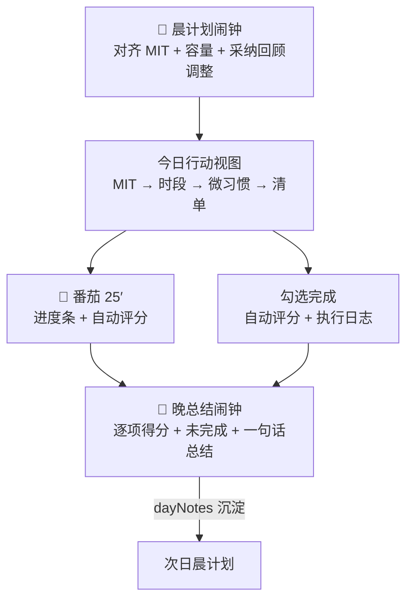

# GoalFlow 产品全景：目的 · 流程 · 功能 · 科学分析

> 本文是 GoalFlow（目标流）的产品级梳理：项目定位、用户流程、功能全景，
> 并从**行为科学**与**可用性**两个角度分析现有设计的依据与可改进点。
> 版本基线：v6.2（2026-11）。

---

## 1. 项目目的

**一句话**：把一整年的目标画成一条「精力河流」，让"当下最重要"自己发光，并用仪式闭环保证执行落地。

**要解决的问题**：待办清单驱动的执行方式，会让人优先做最简单的事，而不是最重要的事。
"重要不紧急"（战略象限）从未被真正安排进时间表。本工具的立场不是教用户"要事第一"，
而是让用户**看见**精力错配——看见，才有选择。

**设计立场**：
- 纯本地、双击即用、无账号无云端（数据主权在用户）；
- 算法替用户做"先做哪个"的决策（减少决策消耗）；
- 不是记录工具，是**行为改变工具**——每个功能背后都应对应一个行为科学机制。

---

## 2. 核心流程

### 2.1 目标生命周期（PDCA 大闭环）

### 2.2 每日流程（小闭环）

### 2.3 每周节奏

- **周一晨**：自动弹周计划——从全部工作流 `im≥4` 的叶子里选 ≤5 块「大石头」（Covey 大石头优先）；
- **每天**：石头条显示在今日面板，可勾选；
- **周日/周末**：周回顾仪式（自动预填：完成叶子、金线动静、核心 vs 救火计数、估 vs 实）→ 填写「下周期调整」→ 进入 `pendingActions` → 次日晨计划一键采纳为今日任务（PDCA 的 Act 落地）。

---

## 3. 功能全景（v6.2）

### 3.1 三视图（v6.0 拆分）

| 视图 | 定位 | 内容 |
|------|------|------|
| ☀ 今日行动 | 每天的主页 | 英雄卡（Top1+备选）、番茄条、今日面板（闹钟条/容量/评分/石头/停滞预警/精力打卡/时间审计/MIT/时段/微习惯/清单）、聚焦清单（Top3+Backlog 泳道） |
| 🎯 目标规划 | 建目标 | 自由文本输入（10 套示例）、树形内联维护、SMART 体检+对话拆解、事前验尸卡、DeepSeek 可选接入 |
| 📊 归纳洞察 | 分析与校准 | 精力流向图（桑基/关系/看板/脑图/365热力 × 年/月/周/日缩放、聚焦模式、节奏条）、四象限拖拽校准、价值×费力矩阵、⚡快速赢筛选 |

### 3.2 仪式层（行为闭环的发动机）

晨计划 / 晚总结 / 周计划 / 周回顾 / 月季回顾——全部由页面弹窗承载，30s 轮询 + 可见性恢复补检查（v6.2 移动端兜底）。

### 3.3 底层机制

- **选择算法**：`focusScore = 重要度×10 + 期限临近加权`，`pickRanked` 取 Top1/2/3；
- **多工作流**：每个目标流独立树 + 起止日期 + 标签，今日面板跨流汇总；
- **数据**：localStorage 双写备份 + JSON 导出/导入 + ICS 导出；备份格式 v9；
- **度量**：OKR 角色（O/KR/习惯）、`targetNum/targetDone`、pace line、365 热力、习惯 streak；
- **移动端 H5（v6.2）**：底部 tab、查看+勾选、弹窗闹钟补跑、桑基横滑、四象限仅查看。

---

## 4. 科学依据映射（现状）

| 功能 | 行为科学机制 | 理论来源 |
|------|-------------|---------|
| 英雄卡 Top1 | 减少决策消耗；Eat the Frog | Brian Tracy；选择架构 |
| 四象限 | 重要/紧急二维分类 | Eisenhower 矩阵；Covey《高效能人士的七个习惯》 |
| 桑基精力图 | 将抽象优先级转为可感知的视觉错配 | 可视化认知（external cognition） |
| SMART 体检 | 目标具体性提升达成率 | Locke & Latham 目标设定理论 |
| 对话拆解 | 降低畏难（任务粉碎） | 行为激活（behavioral activation） |
| 🛡 if-then 预案 | 执行意图：遇障碍自动触发应对 | Gollwitzer 实施意图（effect size d≈.65） |
| 晨计划/晚总结 | 实施意图 + 反思性实践 | WOOP（Oettingen）；经验学习圈 |
| 周/月/季回顾 → 下周期调整 | PDCA 闭环 | Deming 循环 |
| 周计划大石头 | 先排大事，小事填空 | Covey 大石头隐喻 |
| 🍅 番茄 25′ | 时间盒降低启动阻力；即时反馈 | Cirillo 番茄工作法；心流条件（明确目标+即时反馈） |
| 自动评分 + S/A/B/C | 即时反馈强化；游戏化 | 操作性条件反射；自我效能（Bandura） |
| 习惯 streak 🔥 | 连续性不打断（don't break the chain） | Seinfeld 策略；Atomic Habits |
| 🔍 时间审计 + 偏差缓冲 | 计划谬误的事后校准 | Kahneman & Tversky 规划谬误；参考类预测 |
| ⚠️ 停滞预警 | 重新唤醒被搁置承诺 | Zeigarnik 效应（未完成任务的心理张力） |
| 🪦 事前验尸 | 前瞻性事后分析打破乐观偏差 | Gary Klein premortem |
| 🔥 精力曲线匹配 | 昼夜节律下任务-能量匹配 | Circadian rhythm；Managing Energy（Loehr） |
| 时段钉选（When） | 时间分块 | Time-blocking（Cal Newport） |
| 微动作 | 2 分钟启动规则 | GTD；Fogg 微习惯 |

**结论：现状的理论覆盖已经相当全**——执行意图、PDCA、计划谬误、精力管理这四块（v5.4–v5.6）补齐后，
"规划→执行→反馈→调整"的科学闭环在机制层面已完整。改进空间主要在**闭环的薄弱环节**和**积极心理一侧**（见下）。

---

## 5. 科学角度的改进建议

> 按预期收益 / 实现成本排序。每条：理论 → 现状缺口 → 功能形态。

### P0：低成本 × 高证据强度

**5.1 前一晚预选 MIT（Ivy Lee 法）——当前流程最大的时机缺陷**
- 理论：晨间决策消耗最宝贵的自控资源；睡前写下次日计划可利用潜意识孵化，且显著减少睡前反刍（Scullin 2018，写 todo 缩短入睡时间）；Ivy Lee Method（1918）的核心就是"前一晚定 6 件按序执行"。
- 缺口：晨计划 08:30 当天做——醒来第一件事就是高认知负荷决策。
- 形态：晚总结末尾加「明日 MIT 预选」（1 项主选 + 2 项备选，复用 `pickRanked` 推荐）→ 次日晨计划从"从零计划"降级为"确认/微调"。
- 成本：低（一个 meta 字段 + 两处弹窗串联）。

**5.2 晚总结加「三件好事」（峰终定律 + 积极心理学）**
- 理论：人对一天的记忆由峰值与结尾决定（Kahneman Peak-End Rule）；当前晚总结偏"批判性复盘"（未完成、扣分项），以消极收尾损害长期坚持。Seligman「Three Good Things」实证：连续 7 天记录 3 件好事，幸福感提升、抑郁症状下降，效果持续 6 个月。
- 形态：晚总结在逐项得分之后、一句话总结之前，插入「今天值得记住的 1–3 个时刻」（写入 `dayNotes` 结构化字段，周回顾可引用为"本周高光"）。
- 成本：低。

**5.3 倦怠预警（恢复是表现的一部分）**
- 理论：allostatic load——连续高压低恢复导致表现崩塌；精力管理学派强调"脉动"（应激+恢复交替）。
- 数据已具备：`energyLog` 三级打卡 + 评分日志。
- 形态：连续 3 天「精力低 + 评分 C」→ 今日面板温和提示"建议安排恢复日/降低容量"；周回顾展示 14 天能量趋势线。
- 成本：低（纯读已有数据）。

### P1：补齐流程断点

**5.4 快速捕捉 Inbox（GTD 流程缺口）**
- 理论：GTD 五步 Capture→Clarify→Organize→Reflect→Engage。**本系统从 Clarify 开始，缺 Capture**——念头产生时（手机上！）没有低摩擦入口，等到"规划"时已经忘了。这也是移动端最该补的功能（降级策略恰好允许"只做一件事"）。
- 形态：今日视图一个全局「⚡ 捕捉」按钮（桌面快捷键 `c`），一句话存入 `meta.inbox[]`；规划视图输入面板顶部显示未消化 inbox，一键"转为目标"（追加到 textarea 或插入当前流）。
- 成本：中低。

**5.5 Q2（重要不紧急）投入目标线**
- 理论：Covey 建议高效能者 Q2 时间占比 ≥ 65%；四象限分类的意义最终要落到时间分配上。
- 现状：时间审计已按象限分布展示，但只呈现、无目标值、无趋势。
- 形态：审计块加 Q2 占比目标线（默认 50%，可调），低于阈值标黄；周回顾"核心 vs 救火"已有的数据升级为一行"Q2 投入 xx%（目标 50%）"。
- 成本：中低。

**5.6 习惯叠加 anchor（BJ Fogg / Atomic Habits）**
- 理论：「在[既有行为]之后，我将[新习惯]」——既有行为是最可靠的触发线索，比"每天"这种裸时间承诺有效得多。
- 现状：`ifThen` 是障碍预案（WOOP 的 plan），针对"如果受阻"；微习惯没有附着点。
- 形态：微习惯节点增 `anchor` 文本字段（如"早餐后"/"通勤后"），今日面板微习惯区按 anchor 聚类展示；晨计划提醒补齐空 anchor。
- 成本：低。

### P2：机制强化（值得做，但依赖 P0/P1 稳定）

**5.7 承诺卡（commitment device）**
- 理论：损失厌恶 + 一致性偏见；stickK/Beeminder 证明"明确承诺+对照"显著提升履约率。
- 现状：周计划选了石头就完了，没有"承诺"仪式感；周回顾虽有对照但缺少"你当时承诺了"的呈现。
- 形态：周计划确认时生成承诺卡（本周 N 块石头 + 一句话意图，签名式按钮"我承诺"）；周回顾开篇先展示承诺卡再进入统计。
- 成本：中。

**5.8 目标梯度效应可视化**
- 理论：越接近完成动力越强（Kivetz 咖啡卡实验）；"已完成 8/10"比"还剩 2 个"更能驱动最后冲刺。
- 现状：进度数据全有，但呈现偏"仪表盘式"中性。
- 形态：KR 接近完成（≥80%）时英雄卡/侧栏加冲刺提示；子树进度在 90%+ 时显示"还剩 N 个叶子"。
- 成本：低。

**5.9 90′ 深潜块（ultradian rhythm）**
- 理论：BRAC 基本休息-活动周期 90–120 分钟；周回顾模板里"深潜块"概念已存在但没有工具支持。
- 形态：番茄钟除 25′ 外支持 50/90′ 长模式（长模式评分加权）；日视图时段支持整块占用。
- 成本：中。

**5.10 目标归档与庆祝**
- 理论：完成仪式的闭环（termination ritual）强化自我效能；保留已完成目标流在列表里造成视觉噪音与"永远做不完"的错觉。
- 形态：工作流 100% 叶子完成 → 庆祝卡 + 归档区（只读可查，不进今日汇总）。
- 成本：中。

### 不建议做（科学上站不住或与定位冲突）

- ~~惩罚机制（扣分/罚款）~~：外在惩罚侵蚀内在动机（自我决定论）；评分系统保持"只奖励"。
- ~~社交排行榜~~：与"纯本地单机"定位冲突，且社会比较对内在目标有害无益。
- ~~连续打卡断签惩罚~~：现有 streak 只做正向展示是对的，不要加断签负反馈。

---

## 6. 可用性角度的改进建议

| # | 问题 | 建议 | 成本 |
|---|------|------|------|
| U1 | **今日面板 11 个子块信息过载**（闹钟条/容量/评分/石头/停滞/精力/审计/MIT/时段/微习惯/清单） | 渐进披露：审计/停滞/精力默认折叠（`
`），或加「简洁模式」开关只留 MIT+清单 | 低 |
| U2 | 新手空状态无引导 | 三步 onboarding：看示例 → 粘目标 → 设闹钟；首次进入默认载入一套示例而非空白 | 中 |
| U3 | localStorage 单点风险，用户无备份意识 | 距上次备份 >7 天时今日面板提醒条；周回顾完成页带"一键备份" | 低 |
| U4 | 删除节点/清空无撤销 | 危险操作 10 秒可撤销 toast（快照 state.nodes） | 中 |
| U5 | 无键盘效率 | 快捷键：`1/2/3` 切视图、`c` 捕捉、`t` 回今日、空格暂停/继续番茄 | 低 |
| U6 | a11y 薄弱 | 焦点可见样式、aria-label 补齐、light 模式对比度抽查 | 中 |
| U7 | 多设备不同步 | **明确不做**（本地定位）；ICS/JSON 导出已是桥接；远期可评估 WebDAV 单向同步 | 不做/远期 |
| U8 | 移动端只有查看 | 与 5.4 合并：移动端唯一新增的编辑入口 = 「⚡ 捕捉」 | 见 5.4 |

---

## 7. 建议路线图

| 阶段 | 内容 | 状态 |
|------|------|------|
| v6.3 | 5.1 前一晚预选 MIT · 5.2 三件好事 · 5.3 倦怠预警 · U1 折叠次级块 · U3 备份提醒 · U2 onboarding · U4 撤销 | ✅ 已完成（2026-11-23，含 U2/U4 提前并入） |
| v6.4 | 5.4 捕捉 Inbox（移动端 mtab 中央 ⚡FAB 入口 ✅）· 5.5 Q2 目标线（时间审计块+周回顾 Q2 行，可调 10-90%）· 5.6 习惯 anchor（⚓ 习惯叠加聚类）· U5 快捷键（1/2/3 切视图 · t 今日 · c 捕捉 · 空格番茄暂停）· 番茄暂停/继续 | ✅ 已完成（2026-11-25，随 v7.x 重构并入，CSS 补录） |
| v6.5 | 5.7 承诺卡（周计划保存→承诺卡「我承诺」落库 · 周回顾开篇对照履约）· 5.8 梯度冲刺（子树 ≥80% 英雄卡 🔥 冲刺提示）· 5.9 深潜块（番茄 25/50/90′ 三档 · 90′ 评分加权 · 条显 🌊）· 5.10 归档（叶子 100% 完成 → 🏆 归档+庆祝卡 · 侧栏归档区可恢复 · 归档项退出今日汇总/本周承诺/停滞预警/大石头候选） | ✅ 已完成（2026-11-25，22 项全量核查通过） |
| v7.9 | 项目每日可安排时段（winStart/winEnd 注入 AI 排期）· AI 分解失败明示原因+回滚空项目 · 未开始项目不进今日（planDate 到期自动转入）· 全局唯一 MIT（跨项目英雄卡，番茄跨项目归账）· 今日清单时间排序（slot 粗排）+ ⏰提醒/🕐计划时间分工注明 | ✅ 已完成（2026-11-25，22 项全量核查通过） |
| v8.0 | **今日页 UX 精简**（U1 深化）：默认极简 = MIT+清单+习惯，次级全部可点开默认收折——英雄卡 7pill→3pill（得分/进度/节奏收进 details）· 番茄三档改主按钮+档位下拉 · 闹钟条 8 控件→🌅🌙时间+开关+「⏰仪式」菜单 · 度量条 KR 收「指标▾」· 习惯 meta 4 段→1 条 · 容量 3 条→1 条+周预算折叠 · planShare 迁入状态区 · 移动端触控 ≥36px、仪式菜单底部弹出 | ✅ 已完成（2026-11-25，20 项全量核查通过） |
| v8.1 | **移动端 app 化深化**：①布局去「panel 套 panel」→ 今日块/折叠区/英雄卡统一 16px 分组卡（iOS inset-grouped 感）②大石头/情境 chips 折行→单行横滑 ③hero-main 17→21px、大标题 30→32px ④行内 meta 减载：默认只留 项目/🕐/📈/等待阻塞，循环/anchor/标签/剩n天 收进 ⋯ 展开 ⑤底部 tab 玻璃质感与顶栏一致 | ✅ 已完成（2026-11-25，22 项全量核查通过） |

---

## 附：实现位置索引

- 算法：`assets/js/app.js` `focusScore` / `pickRanked` / `sankeyLayout`
- 仪式：`openRitualModal` / `openWeekPlan` / `openWeekReview` / `tickRitualAlarms` / `wakeCheck`
- 评分：`scoreDoneItem` / `scorePomoItem` / `todayScore`（meta `scoreLog`）
- 审计：`timeAudit` / `applyCalibratedBuffer`（meta `executionLog`）
- 数据：`ensureScoreMeta()` 集中管理 meta 默认值；备份格式 v9
- 进度口径：`docs/PROGRESS-ROLLUP.md`（仅叶子计入）
