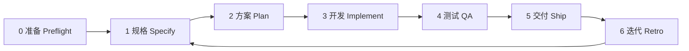

# GoalFlow · 六阶段开发流程

> 改编自 wechat_fitness `docs/preflight/six-stage-workflow.md`：保留「准备→规格→方案→开发→测试→迭代」骨架；去掉应用商店上架，改为版本 bump + 本地备份意识。

## 总览



| 阶段 | 把关 | 本仓工具 / 产物 |
|------|------|-----------------|
| **0 准备** | 产品边界 | [`goalflow.md`](./goalflow.md)、`AGENTS.md`、`openmemory.md` |
| **1 规格** | 产品 | what/why；可选 `docs/superpowers/specs/` |
| **2 方案** | 工程 | 影响函数、存储字段、测试层选择 |
| **3 开发** | 工程 + AI | 最小 diff；`newNode` / `purge*` / modal 壳 |
| **4 测试** | 工程 | unit/flow/smoke/verify；`@goalflow-test-case-generator` |
| **5 交付** | 工程 | bump `?v=` + `--with-checks` 全绿 |
| **6 迭代** | 全员 | 更新 openmemory / TEST-CASES；可选 `/retro` |

## 阶段 0：准备

1. 读 [`goalflow.md`](./goalflow.md)  
2. 确认是否触及：今日池过滤、删除级联、容量口径、跨天缓存、localStorage schema  
3. AI：「对照 preflight 列出缺口，不要 scaffold 新框架」

**退出**：边界清晰；「不做」项无误扩。

## 阶段 1–2：规格与方案

- 大功能：写清用户流程 + 数据字段 + 失败态  
- 方案须回答：改哪些纯函数？要不要新 meta 键？verify 还是 unit？  
- 小改动可口头确认后跳过文档落盘  

## 阶段 3：开发

1. 一次一个核心链路（例如「周预算超支警告」）  
2. 每步可运行（浏览器打开 `index.html`）+ 测试命令  
3. 密钥不进仓；OpenMemory 不存 secrets  

## 阶段 4：测试

| 类型 | 命令 / Skill |
|------|----------------|
| 语法 | `node --check assets/js/app.js` |
| 守卫 | `node scripts/checks/run.cjs` |
| 行为 | `node scripts/tests/run.cjs` |
| 全量 | `node scripts/tests/run.cjs --with-checks` |
| 用例设计 | `@goalflow-test-case-generator` → 评审后再写自动化 |

原则：**unit 管逻辑，flow 管同步，smoke 管版本修复，verify 管结构不被误删**。

## 阶段 5：交付

1. 四处 `?v=` 同步  
2. 全量测试绿  
3. 若用户依赖跨设备：提醒导出备份（非阻塞，但文档应提及）  

## 阶段 6：迭代

- 对照规格收口  
- 更新 `openmemory.md` Patterns / Components  
- 行为变更 → 旧 verify 断言重定向（滚动版本号断言）  

## 标准起手 Prompt

```
请先阅读 docs/preflight/goalflow.md 与 docs/preflight/six-stage-workflow.md。
对照现有仓库列出边界与测试缺口，不要引入新后端或前端框架。
确认后再实现：[具体功能]。
每步给出 node 可验证命令。
```
